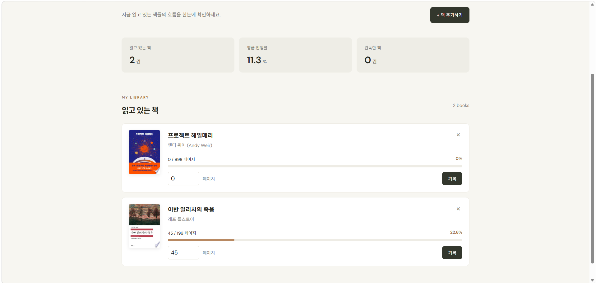
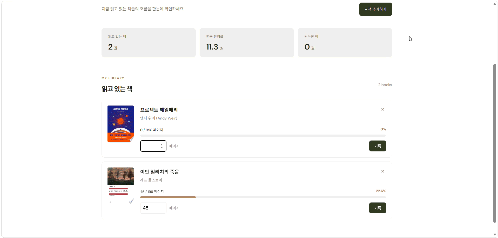
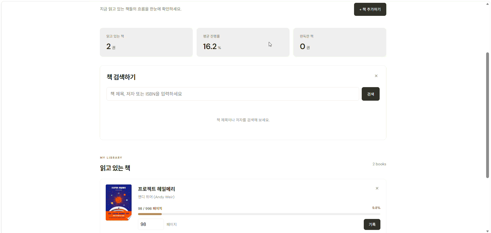

# 📚 Parallel Reads

**여러 권의 책을 동시에 읽는 독자를 위한 독서 진행 관리 서비스**

병렬 독서를 좋아하세요?

Parallel Reads는 여러 권의 책을 동시에 읽는 독자를 위해 도서별 독서 진행 상황을 한눈에 확인하고 관리할 수 있도록 만든 웹 애플리케이션입니다.

Google Books API를 활용한 도서 검색부터 서재 등록, 현재 페이지 기록, 독서 진행률 확인까지 하나의 서비스에서 관리할 수 있습니다.

---

## 🖥️ Preview

### 대시보드

여러 권의 독서 현황과 전체 진행 통계를 한눈에 확인할 수 있습니다.



### 독서 진행률

도서별 현재 페이지를 입력하고 전체 페이지를 기준으로 독서 진행률을 관리할 수 있습니다.



### 새로운 도서 추가

새로운 도서를 검색하여 추가할 수 있습니다.



---

## ✨ Features

### 1. Book Management
- Google Books API를 활용한 도서 검색
- 검색 결과에서 원하는 도서를 서재에 등록
- 도서 정보 및 표지 이미지 조회
- 등록된 도서 삭제
- 도서별 전체 페이지 수 등록 및 수정

### 2. Reading Progress
- 도서별 현재 읽은 페이지 기록 및 수정
- 현재 페이지와 전체 페이지를 기반으로 독서 진행률 자동 계산
- 페이지 범위를 검증하여 잘못된 입력 방지
- 진행률을 시각적인 프로그레스 바로 표시

### 3. Dashboard
- 등록된 도서의 독서 현황 통합 조회
- 읽고 있는 책 수 및 완독한 책 수 표시
- 평균 독서 진행률 계산

---

## 🛠️ Tech Stack

| Category | Technology |
|---|---|
| Language | Java 21, JavaScript |
| Backend | Spring Boot |
| Frontend | React, Vite |
| Database | PostgreSQL |
| ORM | Spring Data JPA, Hibernate |
| API Documentation | Springdoc OpenAPI |
| Build Tool | Gradle |

---

## 🏗️ Project Structure

```text
parallel-reads/
├── backend/
│   └── src/main/
│       ├── java/com/parallelreads/
│       │   ├── book/
│       │   ├── progress/
│       │   ├── dashboard/
│       │   ├── external/
│       │   └── common/
│       └── resources/
│           └── db/migration/
│
├── frontend/
│   └── src/
│       ├── api/
│       ├── components/
│       ├── App.jsx
│       └── style.css
│
├── docs/
│   └── screenshot/
│
└── README.md
```

---

## 🔌 API

| Method | Endpoint | Description |
|---|---|---|
| GET | `/api/books` | 도서 목록 조회 |
| GET | `/api/books/{bookId}` | 도서 상세 조회 |
| POST | `/api/books` | 도서 등록 |
| DELETE | `/api/books/{bookId}` | 도서 삭제 |
| PATCH | `/api/books/{bookId}/total-pages` | 전체 페이지 수 수정 |
| POST | `/api/books/{bookId}/progress` | 독서 진행 정보 등록 |
| PATCH | `/api/books/{bookId}/progress` | 독서 진행 정보 수정 |
| GET | `/api/books/{bookId}/progress` | 독서 진행 정보 조회 |
| GET | `/api/dashboard` | 대시보드 조회 |
| GET | `/api/external/books/search` | 외부 도서 검색 |

---

## 🚀 Getting Started

### Prerequisites

- Java 21
- Node.js
- PostgreSQL
- Google Books API Key

### 1. Clone Repository

```bash
git clone https://github.com/USERNAME/parallel-reads.git
cd parallel-reads
```

### 2. Database Configuration

PostgreSQL에 `parallel_reads` 데이터베이스를 생성합니다.

### 3. Backend Environment Variables

다음 환경변수를 설정합니다.

```properties
DB_URL=jdbc:postgresql://localhost:5432/parallel_reads
DB_USERNAME=postgres
DB_PASSWORD=your_password
GOOGLE_BOOKS_API_KEY=your_api_key
```

### 4. Run Backend

```bash
cd backend
```

Windows:

```powershell
.\gradlew.bat bootRun
```

macOS / Linux:

```bash
./gradlew bootRun
```

### 5. Run Frontend

새 터미널에서 실행합니다.

```bash
cd frontend
npm install
npm run dev
```

브라우저에서 `http://localhost:5173`에 접속합니다.

---

## 📌 Roadmap

- [ ] 독서 기록 및 통계 기능 확장(e예상 완독 시점 계산기, 완독 도서 모아보기)
- [ ] 독서 진행 이력 시각화(독서 리듬)
- [ ] 반응형 UI 개선
- [ ] 테스트 코드 확장
- [ ] CI/CD 구축 및 배포

